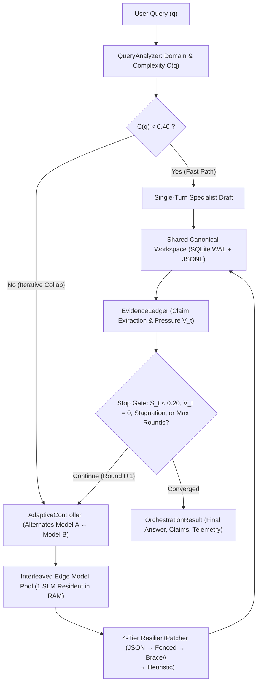

# CoDraft+: Resource-Aware Multi-Model Collaboration via a Shared Canonical Workspace

[](https://www.python.org/)
[](LICENSE)
[]()
[]()

> **CoDraft+** is a resource-aware collaborative multi-LLM framework engineered for consumer-grade laptops and edge devices (<8 GB RAM). Instead of generating separate parallel responses or running verbose multi-agent debates, heterogeneous small language models iteratively build, patch, and verify **one single evolving answer** inside a versioned, section-addressed workspace.

---

## Architecture & Workflow



### Core Capabilities
1. **Shared Canonical Workspace (`codraft/storage.py`)**: Organizes evolving answers into addressable Markdown sections with ACID versioning in embedded SQLite (`WAL` mode) and append-only JSONL history—keeping prompt growth linear $O(TL)$ instead of quadratic $O(KLT^2)$.
2. **4-Tier Resilient Patcher (`codraft/patcher.py`)**: Small models frequently emit imperfect JSON. CoDraft+ applies a 4-tier recovery cascade—(1) direct `json.loads()`, (2) Markdown ```` ```json``` ```` extraction, (3) outermost `{...}` slicing with unescaped newline repair, and (4) heuristic prose fallback—achieving 0% unrecoverable patch crashes.
3. **Multi-Signal Adaptive Controller (`codraft/controller.py`)**: Routes simple queries ($C(q) < 0.40$) to a single-turn fast path and scores multi-turn urgency via $S_t = 0.35\,C(q) + 0.25\,U_t + 0.25\,\Delta_{\text{diff}, t} + 0.15\,V_t$, halting cleanly on stagnation ($\Delta_{\text{diff}} < 0.04$), verified stability ($V_t = 0$), or convergence ($S_t < 0.20$).
4. **Claim-Centric Evidence Ledger (`codraft/evidence.py`)**: Extracts deduplicated factual assertions, tracks per-model provenance, and computes Laplace-smoothed verification pressure $V_t$.
5. **Pluggable Local Backends & Telemetry (`codraft/engine.py`, `codraft/profiler.py`)**: Supports `HuggingFaceEngine` (local CPU/GPU Transformers), `OllamaEngine` (local quantized edge serving with RAM keep-alive control), and `OpenAIEngine`, with live wall-clock latency, token, and peak resident RAM profiling.

---

## Installation & Quick Start

### 1. Environment Setup
```bash
git clone https://github.com/satyamsrj/codraft-plus.git
cd codraft-plus
pip install -r requirements.txt
```

### 2. Run Unit Tests
```bash
python -m pytest tests/test_codraft.py -v
```
*(12/12 unit tests covering query analysis, 4-tier patching, section addressing, evidence ledger, adaptive stopping, storage, and orchestration.)*

### 3. CLI Execution (Ollama Local Models)
```bash
ollama pull qwen2.5:3b
ollama pull gemma3:1b

# Analyze query complexity and recommended routing
python -m codraft.cli analyze "Compare trade-offs between Kalman filters and particle filters."

# Run adaptive collaborative drafting
python -m codraft.cli ask "Compare trade-offs between Kalman filters and particle filters."
```

### 4. FastAPI Microservice
```bash
uvicorn codraft.server:app --host 0.0.0.0 --port 8000
```

---

## Evaluation Harness & Reproducibility

The `eval/` suite evaluates sub-50M open-weight checkpoints across three architectural families (**Pythia / GPT-NeoX**, **BabyLM / GPT-BERT**, and **Stentor2 / Llama**) under a standardized five-configuration protocol using genuine FP32 forward passes (zero synthetic data):

| Config | Paradigm | Description |
| :--- | :--- | :--- |
| **E1** | Small A Solo | Single-turn generation by Specialist A |
| **E2** | Small B Solo | Single-turn generation by Specialist B |
| **E3** | Isolated Ensemble (A + B) | Parallel generation without shared-workspace communication |
| **E4** | **CoDraft+ (Ours)** | Iterative shared-workspace patching, evidence ledger, & adaptive stopping |
| **E5** | Large Baseline Solo | Monolithic reference checkpoint ($1.58\times$–$1.81\times$ combined parameter scale) |

### Running Verification & Benchmarks
```bash
# Verify local Hugging Face checkpoints and parameter scales
python eval/verify_checkpoints.py

# Run benchmark suites
python eval/benchmark.py
python eval/benchmark_suite.py
python eval/run_full_validation.py
```

---

## Repository Structure

```text
codraft-plus/
├── codraft/
│   ├── __init__.py           # Package exports
│   ├── analyzer.py           # Query domain classifier & complexity score C(q)
│   ├── cli.py                # Command-line interface
│   ├── config.py             # Runtime settings & controller hyperparameters
│   ├── controller.py         # Multi-signal urgency S_t & adaptive stopping gates
│   ├── engine.py             # HuggingFace, Ollama, and OpenAI-compatible engines
│   ├── evidence.py           # Atomic claim extraction & verification pressure V_t
│   ├── model_sets.py         # Frozen open-weight model family registry (Sets 1–3)
│   ├── orchestrator.py       # Core async collaborative execution loop
│   ├── patcher.py            # 4-tier resilient JSON/section patcher & diff churn
│   ├── profiler.py           # Wall-clock latency, token, & peak RSS RAM profiler
│   ├── server.py             # FastAPI REST service
│   ├── storage.py            # SQLite WAL + In-Memory + JSONL state storage
│   └── types.py              # Structured dataclasses (Patch, DraftState, Claim, Metrics)
├── eval/
│   ├── benchmark.py          # Core E1–E5 benchmark runner
│   ├── benchmark_suite.py    # Multi-track & cross-architecture evaluation suite
│   ├── metrics.py            # Token F1, ROUGE-L, BLEU-1, & statistical CI utilities
│   ├── run_full_validation.py# End-to-end validation harness (Gates G1–G10)
│   └── verify_checkpoints.py # Offline checkpoint & parameter verification
├── tests/
│   └── test_codraft.py       # Automated pytest unit test suite (12/12 passing)
├── .gitignore
├── LICENSE                   # Apache License 2.0
├── README.md
└── requirements.txt
```

---

## License

Licensed under the **Apache License, Version 2.0**. See [LICENSE](LICENSE) for full terms.
